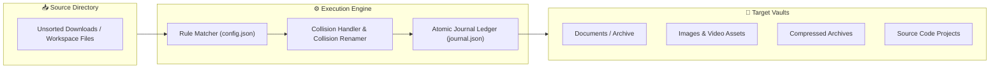

<div align="center">

# 🗂️ FileOrganizer

<p align="center">
  
</p>

<p align="center">
  <strong>Automated Multi-Extension File Classification, Safe Relocation & Journaled Storage Organizer</strong>
</p>

<!-- Badges -->
<p align="center">
  <a href="https://learn.microsoft.com/en-us/powershell/"></a>
  <a href="https://www.python.org/downloads/"></a>
  <a href="https://coderabbit.ai"></a>
  <a href="LICENSE"></a>
</p>

<p align="center">
  
  
  
</p>

---

</div>

## 📌 Architecture & Execution Flow



---

## ⚡ Key Capabilities

* **Dual Engine Flexibility:** Run via Python (`organizer_engine.py`) or natively in PowerShell (`Invoke-FileOrganizer.ps1`).
* **Conflict Resolution:** Safely renames duplicate file names with clean revision increments rather than overwriting existing data.
* **Transaction Journaling:** Records each operation to `journal.json` for full rollback capability.

---

## 🚀 Quickstart

```powershell
# Clone the repository
git clone https://github.com/Anudeep-Adari/FileOrganizer.git
cd FileOrganizer

# Run natively in PowerShell
.\Invoke-FileOrganizer.ps1 -DryRun   # Preview changes without moving
.\Invoke-FileOrganizer.ps1          # Execute file organization
```

---

<div align="center">

Crafted with high engineering precision by **[Anudeep Adari](https://github.com/Anudeep-Adari)**  
Continuous AI Code Reviews powered by **CodeRabbit**

</div>
